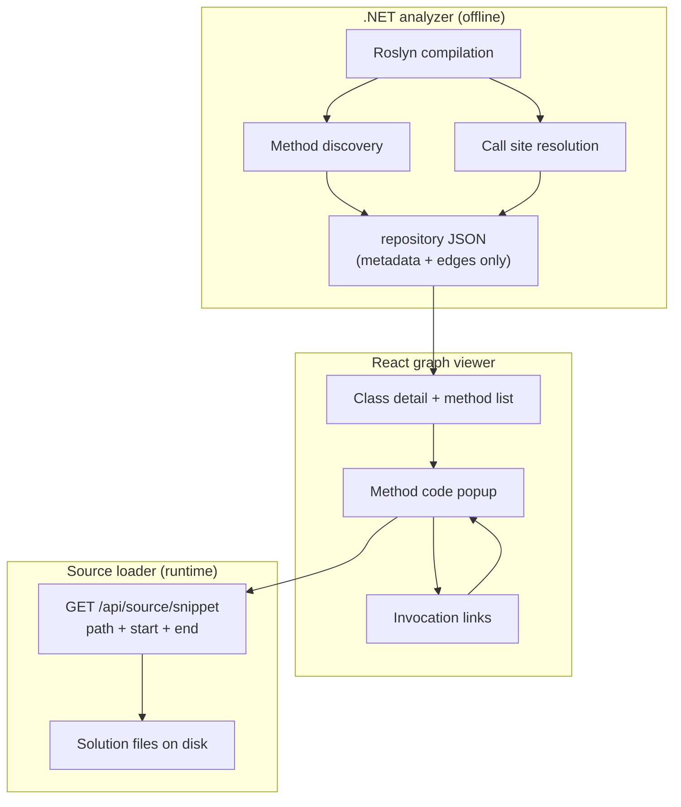

# Method call graph — design plan

This document describes how to extend **ProjectExplorer** with **method-level** navigation: metadata and call edges in the JSON cache, **source code loaded on demand** from disk when the user opens a method, and **click-through** on invocations inside the popup to walk the call graph—without storing method bodies in the graph cache.

---

## Goals

| Goal | Description |
|------|-------------|
| **Method catalog** | Per class, list methods (name, signature, accessibility, static/virtual, etc.) in the cache. |
| **Call graph edges** | Store **caller → callee** relationships as stable IDs (hashes), not source text. |
| **On-demand source** | When the user opens a method, read **only that method’s span** from the file path already known to Roslyn. |
| **Clickable invocations** | Inside the popup, each resolved call site is a link; click opens the callee’s method body the same way. |
| **Consistent IDs** | Same method always maps to the same `MethodHash` across analysis runs (for a given signature string). |

## Non-goals (initial phases)

- Storing full method source or entire files in `repository/`.
- Sound whole-program analysis (virtual dispatch, reflection, delegates) in v1—document as limitations.
- Replacing the 3D **type** graph with a 3D **method** graph (optional later; v1 can be type graph + method popup).
- Running analysis inside the browser (analysis stays in .NET; viewer consumes JSON + source API).

---

## User experience (target)

```text
[3D type graph]  →  click class node  →  detail panel lists methods
                                              ↓ click method
                                    [Code popup: method body only]
                                              ↓ click Foo.Bar() inside body
                                    [Same popup navigates to Foo.Bar body]
                                    [Optional: breadcrumb / back stack / mini call-graph strip]
```

**Screenshots (future):** add under `docs/screenshots/` e.g. `06-method-list.png`, `07-method-popup.png`, `08-invocation-click.png`.

---

## Architecture overview



**Principle:** JSON answers *what exists* and *who calls whom*; the **source API** answers *what the code looks like* at click time.

---

## Phase 1 — Data model (JSON cache)

Keep the existing solution bundle and add **method artifacts** next to type data (same `repository/{Solution}/` folder).

### 1.1 `MethodNode` (stored in `*Methods.json` or nested under type)

One entry per method, keyed by **`MethodHash`**:

```json
{
  "a1b2c3…": {
    "MethodHash": "a1b2c3…",
    "TypeHash": "e26486f9…",
    "Name": "RunInference",
    "DisplayName": "AIManager.RunInference(Bitmap frame)",
    "Kind": "Method",
    "Accessibility": "Private",
    "IsStatic": false,
    "IsAbstract": false,
    "Location": {
      "FilePath": "/abs/path/AIManager.cs",
      "StartLine": 120,
      "StartColumn": 5,
      "EndLine": 185,
      "EndColumn": 6
    }
  }
}
```

- **`TypeHash`**: existing `TreeNode.HashName` for the containing type.
- **`Location`**: from `ISymbol.Locations` / `DeclaringSyntaxReference` (single primary location for v1).
- **No `Body` or `SourceText` field.**

Optional index on type:

```json
// In TreeNode or sidecar TypeMethods.json
"typeHash": ["methodHash1", "methodHash2"]
```

### 1.2 `MethodCalls.json` (call graph edges)

Directed edges, caller → callee (compact):

```json
{
  "callerMethodHash": ["calleeMethodHash1", "calleeMethodHash2"],
  "unresolved:callerMethodHash": [
    {
      "CalleeDisplayName": "SomeExternal.Lib.DoWork()",
      "CallSite": { "FilePath": "…", "StartLine": 42, "StartColumn": 10, "Length": 15 }
    }
  ]
}
```

- **Resolved** callees: `IMethodSymbol` (or property/event accessor) mapped to `MethodHash`.
- **Unresolved**: external assemblies, dynamic, `var` late-bound, etc.—still show call site in UI but no navigation target (or link to metadata only).

### 1.3 Call sites for highlighting (per method, optional file)

For rich “click this invocation” UX, store **call sites inside the caller’s body** (still no source text):

```json
{
  "callerMethodHash": [
    {
      "CalleeMethodHash": "…",
      "Span": { "StartLine": 130, "StartColumn": 12, "EndLine": 130, "EndColumn": 28 },
      "IsResolved": true
    }
  ]
}
```

This can live in `MethodCallSites.json` or be embedded in `MethodNode` as `OutgoingCalls[]` to avoid a second lookup when opening a method.

### 1.4 `MethodHash` algorithm

Align with existing `TreeNode.GenerateMD5`:

```text
MethodHash = MD5( "{FullyQualifiedType}.{MethodName}({paramTypes})" )
```

Use Roslyn `ISymbol.ToDisplayString(SymbolDisplayFormat.FullyQualifiedFormat)` (or a fixed format) so overloads differ. Document the exact format in code and README.

**Alternative:** use Roslyn **documentation comment ID** string if you need stable IDs closer to IDE behavior—pick one and never mix.

---

## Phase 2 — .NET analyzer changes

### 2.1 New components

| Component | Responsibility |
|-----------|----------------|
| `MethodAnalyzer` (or extend `AnalyzationClient`) | Per `INamedTypeSymbol`, enumerate `GetMembers()` methods (filter constructors/operators as needed). |
| `CallGraphBuilder` | Per method body, walk `InvocationExpressionSyntax`, `MemberAccessExpressionSyntax`, object creation, etc. |
| `MethodNodeManager` | Register methods, dedupe by `MethodHash`, emit JSON. |
| `SymbolLocationMapper` | File path + `TextSpan` / line-column from `Location`. |

### 2.2 Roslyn walk (per class)

1. **Discover types** (existing): classes (+ later records/structs if desired).
2. **Discover methods** for each `INamedTypeSymbol`:
   - `IMethodSymbol` where `MethodKind == Ordinary` (and optionally constructors).
   - Skip compiler-generated where appropriate (`IsImplicitlyDeclared`, etc.).
3. **For each method** with a body (`HasBody` or async expression-bodied):
   - Get `MethodDeclarationSyntax` / `AccessorDeclarationSyntax`.
   - `SemanticModel.GetDeclaredSymbol` → `MethodHash`.
   - Record `Location` span.
4. **For each call site** in body (`DescendantNodes`):
   - `InvocationExpressionSyntax`, `ObjectCreationExpressionSyntax`, etc.
   - `SemanticModel.GetSymbolInfo` → `IMethodSymbol` if resolved.
   - Record edge caller → callee + **span of the invocation expression** in the caller’s file.

### 2.3 Write outputs (mirror type bundle)

After each project (or once per solution):

```text
repository/{Solution}/
  {Project}Methods.json      # MethodHash → MethodNode
  {Solution}.methodcalls.json # optional global merge of edges
```

Or a single `{Solution}.methods.json` + `{Solution}.methodcalls.json` for simpler viewer loading.

### 2.4 Performance

- Reuse one `Compilation` per project (already done).
- Limit depth: only analyze methods with source in solution (skip metadata-only).
- Optional: cap methods per type / ignore trivial getters-setters in v1.

---

## Phase 3 — Source loading (not in graph)

The browser **cannot** read `FilePaths` on the user’s machine. You need a **trusted local service**.

### 3.1 Option A — Extend Vite dev plugin (good for dev)

`GET /api/source/snippet?path=…&startLine=…&endLine=…`

- Resolve `path` under an **allowlist** of roots (solution directory + `repository` metadata paths).
- Reject `..` and paths outside roots.
- Read file from disk; return **only the line range** (or full file + client slices).
- Return `{ text, language: "csharp", startLine }` for the editor.

### 3.2 Option B — Small ASP.NET Core sidecar (good for production)

Same contract as A; ships with ProjectExplorer; viewer points to `localhost:5xxx`.

### 3.3 Option C — User picks solution root once

Viewer stores allowed root in `localStorage`; source API validates relative paths from cache against that root (helps when JSON has absolute paths from another machine—may need **path remapping** UI).

### 3.4 Caching

- In-memory LRU in the viewer for snippets already fetched (key = `path + span`).
- No persistence of source in `repository/`.

---

## Phase 4 — React viewer changes

### 4.1 Class detail panel

- After loading `*Nodes.json`, load `*Methods.json` (or methods section).
- Filter methods where `TypeHash === selected.id`.
- Show sortable list: name, accessibility, line range.
- Click row → open **MethodCodePanel**.

### 4.2 `MethodCodePanel` (popup / drawer)

- Fetch snippet via source API using `MethodNode.Location`.
- Display with a lightweight highlighter (e.g. **Shiki**, **Prism**, or **Monaco** read-only).
- Overlay **clickable ranges** for each `OutgoingCalls[].Span`:
  - Map line/column to DOM (per-line spans or Monaco decorations).
  - On click: if `CalleeMethodHash` resolved → fetch callee snippet and push **navigation stack** (back button).
- Show **unresolved** calls as styled text without link, tooltip with `CalleeDisplayName`.

### 4.3 Call graph UX (v1 vs v2)

| v1 | v2 |
|----|-----|
| Stack navigation in popup (caller ← callee) | Side panel tree of callees |
| Optional “Called by” from reverse index | Separate 2D method graph (e.g. react-force-graph) |
| Breadcrumb: `TypeA.Method1 → TypeB.Method2` | Filter by project / namespace |

### 4.4 Bundle loader

Extend `solutionBundle.ts`:

- Load `{Project}Methods.json` files (merge like `*Nodes.json`).
- Load `{Solution}.methodcalls.json` or per-project call files.
- Build reverse map `callee → callers` for “incoming calls” in UI.

---

## Phase 5 — Invocation click implementation detail

**Do not** parse C# in the browser for semantics. Use **analyzer-produced spans**:

1. Server returns raw text for `[StartLine, EndLine]`.
2. Client highlights regions from `OutgoingCalls[].Span` (line/column relative to file).
3. Hit-testing: click within span → lookup call site entry → next `MethodHash`.

**Edge case:** Multi-line invocations—store full span from Roslyn `invocation.FullSpan`, not just member name.

**Edge case:** `global::`, generics, `await` calls—still one `InvocationExpressionSyntax`; symbol resolution handles most cases.

---

## Phase 6 — Security & portability

| Topic | Approach |
|-------|----------|
| Path traversal | Allowlist roots; normalize paths; no arbitrary `path=` |
| Absolute paths in JSON from another OS | “Solution root” mapping in viewer settings |
| Secrets in source | User runs locally; no upload to cloud in default setup |
| Large files | Snippet endpoint only; optional max line count |

---

## Phase 7 — Rollout plan

| Step | Deliverable | Effort (rough) |
|------|-------------|----------------|
| **7.1** | `MethodNode` + `MethodHash` in Forest; write `*Methods.json` | Medium |
| **7.2** | Call site + edge extraction; `methodcalls.json` | Medium–High |
| **7.3** | Source snippet API (Vite plugin) | Small |
| **7.4** | Method list in `NodeDetailPanel` | Small |
| **7.5** | Popup + snippet fetch + span click navigation | Medium |
| **7.6** | Reverse index, breadcrumbs, polish | Small |
| **7.7** | Optional 2D method graph view | Medium |

Implement **7.1 → 7.3 → 7.4 → 7.5** for a minimal vertical slice (one class, a few methods, a few calls).

---

## Limitations to document (honest v1)

- **Virtual/interface calls** may resolve to interface method or base implementation depending on Roslyn binding; may not match runtime target.
- **Delegates, events, dynamic, reflection**: often **unresolved** edges.
- **Partial classes**: merge methods across files; multiple locations may need a list of spans (v2).
- **Generated code**: exclude or tag separately.
- **Cross-solution** references: callee outside analyzed solution → unresolved.

---

## Open decisions (for you to confirm)

1. **Scope of members**: methods only, or include properties (accessor methods as separate nodes)?
2. **Constructors / static constructors**: in graph or excluded?
3. **Single global `methodcalls.json` vs per-project** files?
4. **Source API**: Vite-only vs shared .NET host for `dotnet run` + viewer together?
5. **UI**: modal vs docked panel vs split view with 3D graph?

---

## Summary

- **Cache:** method **metadata** + **call edges** + **call-site spans** keyed by `MethodHash` / `TypeHash`—same bundle pattern as types.
- **Runtime:** **source snippet service** reads lines from disk when the user opens a method; graph stays small and fresh.
- **UX:** method list on class click → popup code → click invocations to walk the call graph via precomputed spans and resolved `MethodHash` links.

Once the open decisions above are fixed, implementation can start with Phase 7.1 without breaking existing type-level JSON consumers.
