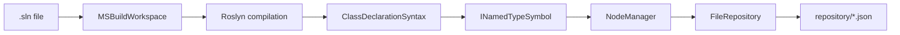
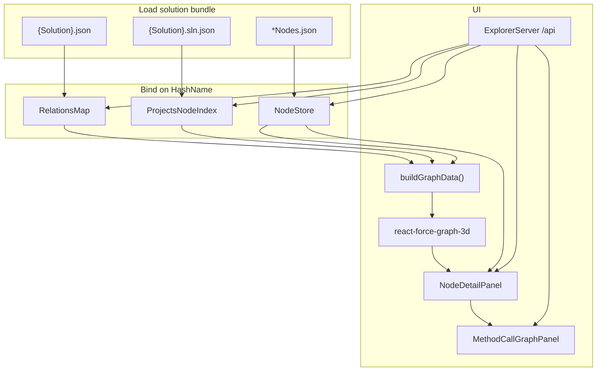

# ProjectExplorer

Analyze a .NET solution with Roslyn, cache the result as JSON, and explore it in the browser: a **3D type hierarchy** plus an interactive **method call graph** (traverse calls and keep method bodies on screen with edges between them).

The pipeline has three parts:

| Part | Technology | Role |
|------|------------|------|
| **Analyzer** | .NET 9 (`ProjectExploration`) | Opens a `.sln`, walks types and methods, writes a **graph cache** under `repository/` |
| **ExplorerServer** | ASP.NET Core API | Serves bundles, type/method metadata, and method source to the viewer |
| **Graph viewer** | React + Vite + Three.js | 3D force graph for types; detail panel and **method call overlay** for invocation navigation |

---

## Screenshots


### Analyzer / repository output

*Example: `repository/Aimmy2/` with `Aimmy2.json`, `Aimmy2.sln.json`, and `Aimmy2Nodes.json`.*


## What problem this solves

Large solutions are hard to reason about from the file tree alone. ProjectExplorer:

1. **Extracts** each class’s base types and interfaces (transitive interfaces included).
2. **Stores** stable **HashName** identifiers (MD5 of the fully qualified type name) so graphs stay compact and mergeable.
3. **Visualizes** parent/child relationships in 3D so you can see clusters, hubs, and dependencies at a glance.
4. **Indexes methods** per type (signatures, file spans, resolved call sites) and lets you **walk method-to-method calls** in a persistent 2D call graph overlay.

Typical uses: onboarding, refactors, finding who implements an interface, following control flow through method calls, or checking what the analyzer captured for a solution.

### Type graph vs method call graph

These are **separate views** on the same analysis run. Class hierarchy logic (`NodeManager`, relations JSON, 3D graph building) was **not redesigned**—method support is **additive**.

| | Type hierarchy (3D) | Method call graph (overlay) |
|--|---------------------|-----------------------------|
| **Shows** | Classes/interfaces, inheritance & implementation | Method source bodies and call edges you open by clicking |
| **Cache** | `{Solution}.json`, `.sln.json`, `*Nodes.json` | `*MethodIndex.json`, `MethodShards/` |
| **Interaction** | Click node → parents, children, files, method list | Click call line → add callee card + SVG edge from that line |

---

## Quick start

### Prerequisites

- [.NET 9 SDK](https://dotnet.microsoft.com/download)
- [Node.js](https://nodejs.org/) 20+ (for the graph viewer)

### 1. Generate the graph cache (.NET)

```bash
cd ProjectExplorer
dotnet run
```

By default, `Program.cs` points at a solution path and a `repository` directory on your machine. **Edit these before running:**

```csharp
var repository = new FileRepository("/path/to/ProjectExplorer/repository");
await analyzer.AnalyzeAsync("/path/to/YourSolution/YourSolution.sln");
```

After a successful run you should see a folder such as:

```text
repository/
  Aimmy2/
    Aimmy2.json              # type hierarchy (edges)
    Aimmy2.sln.json          # project → class hashes
    Aimmy2Nodes.json         # hash → class metadata (per project)
    Aimmy2MethodIndex.json   # methodHash → method metadata + call sites (per project)
    MethodShards/            # methodHash.json → metadata + body lines (fast API reads)
```

For solutions with **multiple projects**, expect one `{ProjectName}Nodes.json` and one `{ProjectName}MethodIndex.json` per project, plus a shared `MethodShards/` folder for that solution.

Re-run analysis via the API when you change code or want fresh shards:

```bash
curl -X POST "http://localhost:5243/api/solutions/Aimmy2/analyze?slnPath=/absolute/path/to/Aimmy2.sln"
```

### 2. Start the API (recommended)

```bash
cd server/ExplorerServer
dotnet run
```

Serves `http://localhost:5243` — see [server/ExplorerServer/README.md](server/ExplorerServer/README.md).

### 3. Open the 3D viewer (React)

```bash
cd graph-viewer
npm install
npm run dev
```

Open `http://localhost:5173`. With the API running, the viewer loads data from `/api/solutions/.../bundle` (Vite proxies `/api` to port 5243). Without the API, it falls back to static JSON under `ProjectExploration/repository/`.

Production build (copies `repository/` into `dist/`):

```bash
npm run build
npm run preview
```

---

## Repository layout (solution bundle)

All cached data for one analyzed **solution** lives in `repository/{SolutionName}/`. Three JSON roles are **joined on HashName**:

| File | Written by | Contents |
|------|------------|----------|
| `{Solution}.json` | `NodeManager.GetRelations()` | `parentHash → [ childHash, … ]` — edges in the graph |
| `{Solution}.sln.json` | Analyzer project map | `projectName → [ hash, … ]` — which types belong to which project |
| `{Project}Nodes.json` | `NodeManager` serialized nodes | `hash → TreeNode` — names, namespaces, file paths, parent/child lists |
| `{Project}MethodIndex.json` | `MethodCallAnalyzer` | `methodHash → MethodMetadata` — type, name, file, body span, `calls[]` with source spans and optional `calleeMethodHash` |
| `MethodShards/{methodHash}.json` | Analyzer (or server backfill) | Same metadata plus **body lines** for one-request loads in the call graph UI |
| `analyze-manifest.json` | `AnalyzationClient` (after each analyze) | **When** the cache was built, **Git commit** (if available), paths to relations/nodes/method index/shards |

### `analyze-manifest.json` (versioning)

Written after every successful analyze. Used later for **commit skew** warnings when investigating production incidents.

| Field | Meaning |
|-------|---------|
| `schemaVersion` | Format version (currently `1`) |
| `analyzedAtUtc` | ISO timestamp of the analyze run |
| `commitSha` / `commitShaShort` | `git rev-parse HEAD` from the repo containing the `.sln` (null if not a git repo or git unavailable) |
| `slnPath` | Absolute path to the solution file that was analyzed |
| `projects` | Project names included in this run |
| `relationsFile`, `slnIndexFile`, `nodeFiles`, `methodIndexFiles`, `methodShardsDirectory` | Cache layout for this folder |

API: `GET /api/solutions/{folder}/analyze-manifest` (distinct from `GET .../manifest`, which lists bundle **file names** discovered on disk).

### Example `TreeNode` (in `*Nodes.json`)

```json
{
  "e26486f9fb3b532a75fbd7f41699ff2f": {
    "ID": "…",
    "Type": 2,
    "HashName": "e26486f9fb3b532a75fbd7f41699ff2f",
    "NameSpace": "Aimmy2.AILogic",
    "Name": "AIManager",
    "Children": [],
    "Parents": ["09435209130fc5f7ca5ed9f32624db84"],
    "FilePaths": ["/path/to/AIManager.cs"]
  }
}
```

`Type` follows `Forest.NodeType`: `None`, `Tree`, `Leave` (serialized as 0, 1, 2).

### HashName

```csharp
TreeNode.GenerateMD5($"{nameSpace}.{name}")
```

Same type always gets the same hash across runs (for a given qualified name), which is how relations and metadata stay linked.

---

## How the .NET analyzer works



### Entry point — `Program.cs`

- Creates `NodeManager` and `FileRepository`.
- Runs `AnalyzationClient.AnalyzeAsync(slnPath)`.
- Optionally demonstrates `GetHierarchy(hash)` for a single type.

### `Analyzation/AnalyzationClient.cs`

1. Registers MSBuild defaults and opens the solution.
2. For each **project**, for each **syntax tree**, finds **class declarations**.
3. For each class symbol:
   - Builds a **child** `TreeNode` for the declared type.
   - Walks **base types** (skips `Object` / `Window`) and adds `AddRelation(child, parent)`.
   - Walks **all interfaces** and adds `AddRelation(child, interface)`.
4. Periodically writes `{Solution}/{Project}Nodes.json` (full node dictionary).
5. When a project **compilation** is available, runs **`MethodCallAnalyzer.AnalyzeCompilation`**:
   - Enumerates ordinary methods, records body spans and invocation call sites (with callee hash when Roslyn resolves the target).
   - Writes `{Solution}/{Project}MethodIndex.json` (metadata only).
   - Writes `{Solution}/MethodShards/{methodHash}.json` (metadata + body text extracted from the syntax tree).
6. After all projects:
   - Writes `{Solution}/{Solution}.json` — relation map.
   - Writes `{Solution}/{Solution}.sln.json` — project → hash sets.

**Edge direction in the cache:** `AddRelation(child, parent)` stores **parent → children** in `_relations`. So in `Aimmy2.json`, keys are base types / interfaces; values are deriving / implementing types.

Method hashes use `MethodMetadata.CreateMethodHash` (qualified type + method name + parameter types). Type hashes in the method index align with `TreeNode` hashing for the containing type.

### `Forest/NodeManager.cs`

- **`_nodes`**: hash → `TreeNode` (metadata, `Parents` / `Children` lists).
- **`_relations`**: parent hash → set of child hashes (exported as JSON arrays).
- **`GetHierarchy(nodeHash)`**: returns parent `TreeNode`s that list this hash as a child.

### `Forest/TreeNode.cs`

Record holding identity (`HashName`, `Name`, `NameSpace`), graph links (`Parents`, `Children`), and `FilePaths` from Roslyn locations.

### `Data/FileRepository.cs`

- Writes JSON under `repository/` using a temp file + rename (safe against partial writes).
- Supports subpaths like `Aimmy2/Aimmy2.json` via `WriteContentAsync`.

### ExplorerServer (`server/ExplorerServer/`)

HTTP API used by the graph viewer (and optional `curl` workflows). Important routes:

| Endpoint | Purpose |
|----------|---------|
| `GET /api/solutions` | List solution folders under `repository/` |
| `GET /api/solutions/{folder}/bundle` | Relations + project index + merged nodes (3D graph) |
| `GET /api/solutions/{folder}/analyze-manifest` | Last analyze time, Git commit, cache file paths |
| `GET /api/solutions/{folder}/nodes/{hash}` | Single `TreeNode` |
| `GET /api/solutions/{folder}/types/{typeHash}/methods` | Methods for a type |
| `GET /api/solutions/{folder}/methods/{methodHash}/source` | Method metadata + body lines (reads **shard** when present) |
| `POST /api/solutions/{folder}/analyze?slnPath=...` | Re-run Roslyn analysis and refresh cache |

On startup, **`MethodShardBackfillHostedService`** can build missing `MethodShards/` from an existing method index (resume-friendly) so older caches gain fast loads without a full re-analyze. Configure `RepositoryLocation` and `SourceRoots` in `appsettings.Development.json`.

See [server/ExplorerServer/README.md](server/ExplorerServer/README.md) for run and config details.

---

## How the graph viewer works



### Key frontend modules (`graph-viewer/src/`)

| Module | Purpose |
|--------|---------|
| `lib/solutionBundle.ts` | Load and merge type-graph JSON (API first, then `repository/` fallback) |
| `lib/explorerApi.ts` | HTTP client for ExplorerServer (bundle, nodes, methods, source) |
| `lib/methodViewCache.ts` | In-memory cache and throttled prefetch for method source views |
| `lib/buildGraphData.ts` | Build `{ nodes, links }` for the force graph |
| `components/GraphViewer3D.tsx` | 3D canvas, colors, camera focus on hash search |
| `components/NodeDetailPanel.tsx` | Type details, parents/children, **method list** (opens call graph) |
| `components/MethodCallGraphPanel.tsx` | Persistent method cards, layout, SVG edges from invocation lines |
| `App.tsx` | Toolbar, 3D graph, detail panel, full-screen method call overlay |

### Dev server and `repository/`

`graph-viewer/vite.config.ts` serves `../repository` at `/repository` and exposes `/api/repository/solution-bundles` so the UI can list solution folders without copying files.

### Viewer behavior (defaults)

- **Nodes shown:** hashes that appear in `{Solution}.json` (as parent or child).
- **Optional:** “Show classes without edges” adds hashes from `.sln.json` with no edge in the relations file.
- **Project dropdown:** filters which orphan hashes are considered; relations still define edges.
- **Browse…:** multi-select local `.json` files (one relations file, one `.sln.json`, any `*Nodes.json`).
- **Method call graph:** select a method from the type panel → overlay opens on the main canvas. Green lines are invocations; click to add the callee and draw an edge from that line. Nodes stay visible as you explore. Requires ExplorerServer and `*MethodIndex.json` (and ideally `MethodShards/`).

Other solutions work with the **same JSON shapes**; names can differ as long as discovery rules are met (see [`graph-viewer/README.md`](graph-viewer/README.md)).

### Method call graph (design summary)

1. **State:** a set of **method nodes** (hash, layout position, source lines) and **edges** `(fromMethod, fromLine) → toMethod`.
2. **Layout:** callees are placed to the right of the caller; siblings stack vertically.
3. **Edges:** SVG paths from the right of the clicked source line to the left of the callee card; updated on scroll/resize.
4. **Loading:** `GET .../methods/{hash}/source` returns metadata + lines in one round trip; client cache avoids duplicate fetches; hover uses low-priority prefetch.

---

## Project structure

```text
ProjectExplorer/
├── README.md                      ← this file
├── ProjectExplorer.sln
├── Program.cs                     ← analyzer entry (console)
├── ProjectExploration/            ← shared analyzer + data libraries
│   ├── Analyzation/
│   │   ├── AnalyzationClient.cs   ← type hierarchy + method index/shards
│   │   └── MethodCallAnalyzer.cs
│   ├── Data/
│   │   ├── FileRepository.cs
│   │   ├── MethodIndexReader.cs
│   │   ├── MethodShardStore.cs
│   │   └── SourceCodeReader.cs
│   ├── Forest/
│   └── repository/                ← generated cache (default output location)
│       └── {Solution}/
├── server/
│   └── ExplorerServer/            ← ASP.NET API
├── graph-viewer/                  ← React UI (3D + method call graph)
│   ├── src/
│   └── README.md
└── docs/
    └── screenshots/
```

---

## Configuration tips

| Goal | Where to change |
|------|------------------|
| Solution to analyze | `Program.cs` → `AnalyzeAsync(...)` |
| Cache output directory | `Program.cs` → `FileRepository(...)` |
| Skip `Object` / `Window` bases | `AnalyzationClient.cs` base-type loop |
| Graph colors / camera | `GraphViewer3D.tsx` |
| Which nodes appear | `buildGraphData.ts`, “orphan” flag in `App.tsx` |
| API URL / proxy | `graph-viewer/vite.config.ts`, `VITE_API_BASE_URL`, `appsettings.Development.json` |
| Source roots for shard backfill | `ExplorerServer` → `SourceRoots` |

---

## Limitations (current)

- Analyzer focuses on **`class` declarations** for the **type graph** (not records/structs/enums unless extended).
- **Type relations** are base types and interfaces only—not project references or member-level coupling.
- **Method call graph:** ordinary methods only; callees must resolve in-source for navigation; external/unresolved calls show as text without a target hash.
- `NodeManager` state is global across projects in one run; node files are rewritten per syntax tree pass (last write wins for `_nodes` content per project file).
- Console `Program.cs` uses **hard-coded paths**; prefer **`POST /api/.../analyze`** or edit paths before `dotnet run` on the analyzer.

---

## License / contributing

Add your license and contribution notes here if this repo is shared publicly.

---

## See also

- [Graph viewer README](graph-viewer/README.md) — bundle naming, browse mode, npm scripts
- [ExplorerServer README](server/ExplorerServer/README.md) — API routes and configuration
- [Method call graph plan](ProjectExploration/docs/METHOD_CALL_GRAPH_PLAN.md) — original design notes for method metadata and navigation
- [Screenshots folder](docs/screenshots/README.md) — suggested image names for the gallery above
