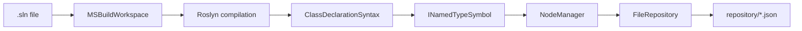
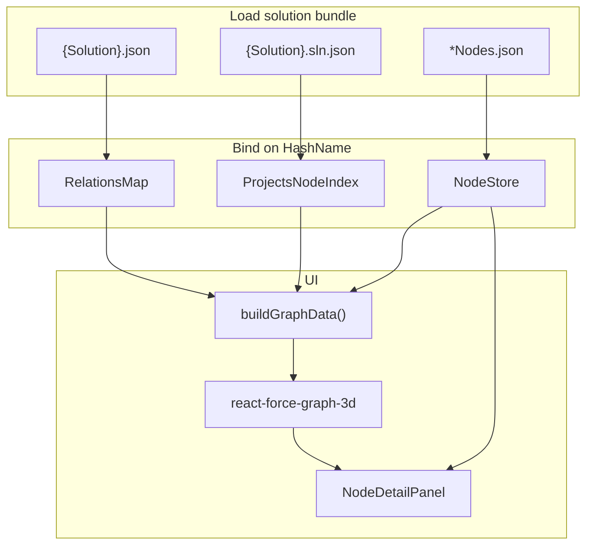

# ProjectExplorer

Analyze a .NET solution with Roslyn, cache the result as JSON, and explore type relationships in an interactive **3D graph** in the browser.

The pipeline has two parts:

| Part | Technology | Role |
|------|------------|------|
| **Analyzer** | .NET 9 console app | Opens a `.sln`, walks C# classes, writes a **graph cache** under `repository/` |
| **Graph viewer** | React + Vite + Three.js | Loads the cache, binds JSON files together, renders a force-directed 3D graph |

---

## Screenshots


### Analyzer / repository output

*Example: `repository/Aimmy2/` with `Aimmy2.json`, `Aimmy2.sln.json`, and `Aimmy2Nodes.json`.*


## What problem this solves

Large solutions are hard to reason about from the file tree alone. ProjectExplorer:

1. **Extracts** each class’s base types and interfaces (transitive interfaces included).
2. **Stores** stable **HashName** identifiers (MD5 of the fully qualified type name) so graphs stay compact and mergeable.
3. **Visualizes** parent/child relationships in 3D so you can see clusters, hubs, and dependencies at a glance.

Typical uses: onboarding, refactors, finding who implements an interface, or checking what the analyzer captured for a solution.

---

## Quick start

### Prerequisites

- [.NET 9 SDK](https://dotnet.microsoft.com/download)
- [Node.js](https://nodejs.org/) 20+ (for the graph viewer)

### 1. Generate the graph cache (.NET)

```bash
cd ProjectExplorer
dotnet run
```

By default, `Program.cs` points at a solution path and a `repository` directory on your machine. **Edit these before running:**

```csharp
var repository = new FileRepository("/path/to/ProjectExplorer/repository");
await analyzer.AnalyzeAsync("/path/to/YourSolution/YourSolution.sln");
```

After a successful run you should see a folder such as:

```text
repository/
  Aimmy2/
    Aimmy2.json           # hierarchy (edges)
    Aimmy2.sln.json       # project → class hashes
    Aimmy2Nodes.json      # hash → class metadata (per project)
```

For solutions with **multiple projects**, expect one `{ProjectName}Nodes.json` per project and multiple keys in `{Solution}.sln.json`.

### 2. Start the API (recommended)

```bash
cd server/ExplorerServer
dotnet run
```

Serves `http://localhost:5243` — see [server/ExplorerServer/README.md](server/ExplorerServer/README.md).

### 3. Open the 3D viewer (React)

```bash
cd graph-viewer
npm install
npm run dev
```

Open `http://localhost:5173`. With the API running, the viewer loads data from `/api/solutions/.../bundle` (Vite proxies `/api` to port 5243). Without the API, it falls back to static JSON under `ProjectExploration/repository/`.

Production build (copies `repository/` into `dist/`):

```bash
npm run build
npm run preview
```

---

## Repository layout (solution bundle)

All cached data for one analyzed **solution** lives in `repository/{SolutionName}/`. Three JSON roles are **joined on HashName**:

| File | Written by | Contents |
|------|------------|----------|
| `{Solution}.json` | `NodeManager.GetRelations()` | `parentHash → [ childHash, … ]` — edges in the graph |
| `{Solution}.sln.json` | Analyzer project map | `projectName → [ hash, … ]` — which types belong to which project |
| `{Project}Nodes.json` | `NodeManager` serialized nodes | `hash → TreeNode` — names, namespaces, file paths, parent/child lists |

### Example `TreeNode` (in `*Nodes.json`)

```json
{
  "e26486f9fb3b532a75fbd7f41699ff2f": {
    "ID": "…",
    "Type": 2,
    "HashName": "e26486f9fb3b532a75fbd7f41699ff2f",
    "NameSpace": "Aimmy2.AILogic",
    "Name": "AIManager",
    "Children": [],
    "Parents": ["09435209130fc5f7ca5ed9f32624db84"],
    "FilePaths": ["/path/to/AIManager.cs"]
  }
}
```

`Type` follows `Forest.NodeType`: `None`, `Tree`, `Leave` (serialized as 0, 1, 2).

### HashName

```csharp
TreeNode.GenerateMD5($"{nameSpace}.{name}")
```

Same type always gets the same hash across runs (for a given qualified name), which is how relations and metadata stay linked.

---

## How the .NET analyzer works



### Entry point — `Program.cs`

- Creates `NodeManager` and `FileRepository`.
- Runs `AnalyzationClient.AnalyzeAsync(slnPath)`.
- Optionally demonstrates `GetHierarchy(hash)` for a single type.

### `Analyzation/AnalyzationClient.cs`

1. Registers MSBuild defaults and opens the solution.
2. For each **project**, for each **syntax tree**, finds **class declarations**.
3. For each class symbol:
   - Builds a **child** `TreeNode` for the declared type.
   - Walks **base types** (skips `Object` / `Window`) and adds `AddRelation(child, parent)`.
   - Walks **all interfaces** and adds `AddRelation(child, interface)`.
4. Periodically writes `{Solution}/{Project}Nodes.json` (full node dictionary).
5. After all projects:
   - Writes `{Solution}/{Solution}.json` — relation map.
   - Writes `{Solution}/{Solution}.sln.json` — project → hash sets.

**Edge direction in the cache:** `AddRelation(child, parent)` stores **parent → children** in `_relations`. So in `Aimmy2.json`, keys are base types / interfaces; values are deriving / implementing types.

### `Forest/NodeManager.cs`

- **`_nodes`**: hash → `TreeNode` (metadata, `Parents` / `Children` lists).
- **`_relations`**: parent hash → set of child hashes (exported as JSON arrays).
- **`GetHierarchy(nodeHash)`**: returns parent `TreeNode`s that list this hash as a child.

### `Forest/TreeNode.cs`

Record holding identity (`HashName`, `Name`, `NameSpace`), graph links (`Parents`, `Children`), and `FilePaths` from Roslyn locations.

### `Data/FileRepository.cs`

- Writes JSON under `repository/` using a temp file + rename (safe against partial writes).
- Supports subpaths like `Aimmy2/Aimmy2.json` via `WriteContentAsync`.

---

## How the graph viewer works



### Key frontend modules (`graph-viewer/src/`)

| Module | Purpose |
|--------|---------|
| `lib/solutionBundle.ts` | Load and merge the three JSON roles from `repository/{folder}/` |
| `lib/discoverSolutionFolder.ts` | Detect valid bundle filenames in a folder or file picker |
| `lib/buildGraphData.ts` | Build `{ nodes, links }` for the force graph |
| `lib/nodeDetails.ts` | Labels, neighbors, project membership for the detail panel |
| `components/GraphViewer3D.tsx` | 3D canvas, colors, camera focus on search |
| `components/NodeDetailPanel.tsx` | Click details: type, parents, children, files |
| `App.tsx` | Toolbar: solution, project, hash search, browse local JSON |

### Dev server and `repository/`

`graph-viewer/vite.config.ts` serves `../repository` at `/repository` and exposes `/api/repository/solution-bundles` so the UI can list solution folders without copying files.

### Viewer behavior (defaults)

- **Nodes shown:** hashes that appear in `{Solution}.json` (as parent or child).
- **Optional:** “Show classes without edges” adds hashes from `.sln.json` with no edge in the relations file.
- **Project dropdown:** filters which orphan hashes are considered; relations still define edges.
- **Browse…:** multi-select local `.json` files (one relations file, one `.sln.json`, any `*Nodes.json`).

Other solutions work with the **same JSON shapes**; names can differ as long as discovery rules are met (see [`graph-viewer/README.md`](graph-viewer/README.md)).

---

## Project structure

```text
ProjectExplorer/
├── README.md                 ← this file
├── ProjectExplorer.sln
├── Program.cs                ← analyzer entry
├── Analyzation/
│   └── AnalyzationClient.cs  ← Roslyn solution walk
├── Data/
│   └── FileRepository.cs     ← JSON cache I/O
├── Forest/
│   ├── TreeNode.cs
│   ├── NodeManager.cs
│   └── NodeType.cs
├── repository/               ← generated cache (git-track or gitignore as you prefer)
│   └── {Solution}/
├── graph-viewer/             ← React 3D UI
│   ├── src/
│   ├── package.json
│   └── README.md             ← viewer-only notes
└── docs/
    └── screenshots/          ← add PNGs for README gallery
```

---

## Configuration tips

| Goal | Where to change |
|------|------------------|
| Solution to analyze | `Program.cs` → `AnalyzeAsync(...)` |
| Cache output directory | `Program.cs` → `FileRepository(...)` |
| Skip `Object` / `Window` bases | `AnalyzationClient.cs` base-type loop |
| Graph colors / camera | `GraphViewer3D.tsx` |
| Which nodes appear | `buildGraphData.ts`, “orphan” flag in `App.tsx` |

---

## Limitations (current)

- Analyzer focuses on **`class` declarations** (not records/structs/enums unless extended).
- Relations reflect **base types and interfaces** from Roslyn; not method calls or project references.
- `NodeManager` state is global across projects in one run; node files are rewritten per syntax tree pass (last write wins for `_nodes` content per project file).
- `Program.cs` uses **hard-coded paths**; there is no CLI argument parsing yet.

---

## License / contributing

Add your license and contribution notes here if this repo is shared publicly.

---

## See also

- [Graph viewer README](graph-viewer/README.md) — bundle naming, browse mode, npm scripts
- [Method call graph plan](docs/METHOD_CALL_GRAPH_PLAN.md) — method metadata, on-demand source, invocation navigation
- [Screenshots folder](docs/screenshots/README.md) — suggested image names for the gallery above
