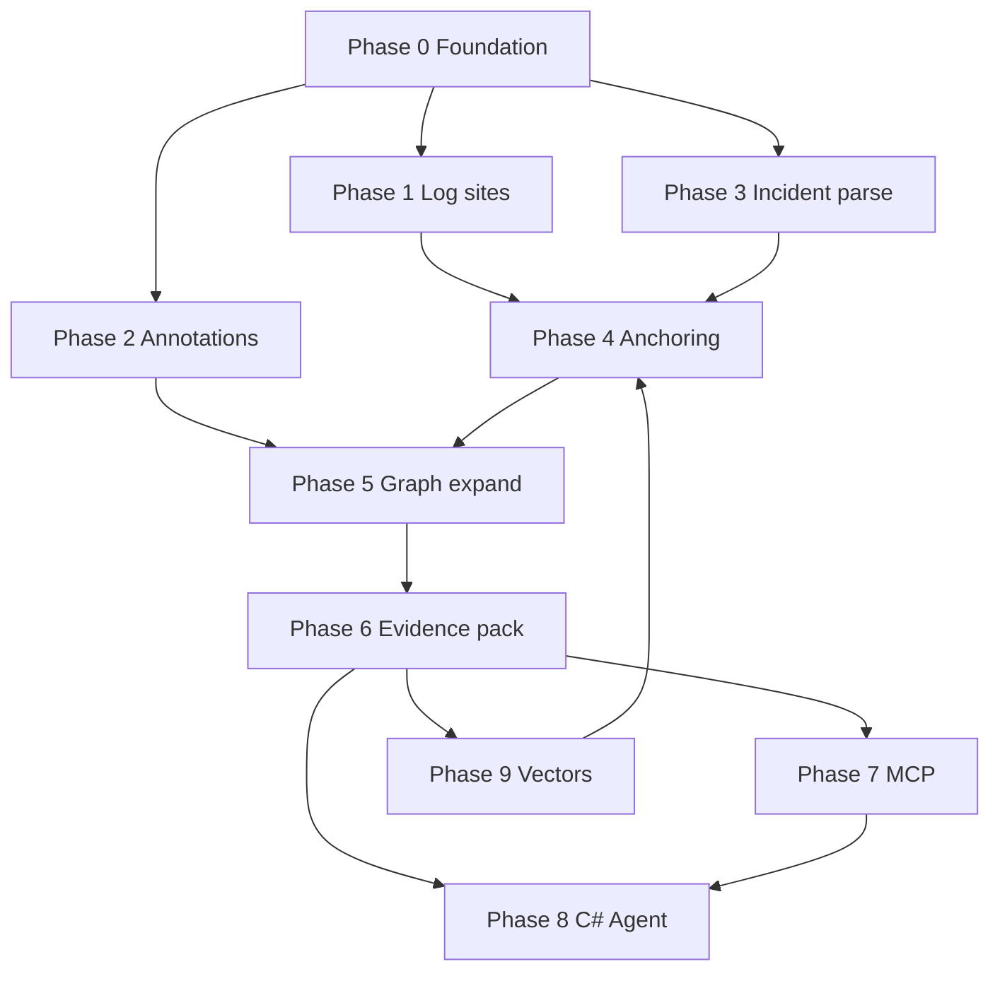

# Roadmap: ProjectExplorer → C# incident investigator (MCP + agent)

Goal: From production log details (and stack traces), **anchor** to code, **expand** on the type/method graph, build a **bounded evidence pack**, and let a **C#-hosted agent** propose **ranked, cited hypotheses**—exposed to Claude Code / Cursor via **MCP**.

**Stack constraint:** orchestration, MCP, analysis extensions, retrieval, and LLM calls are **C# / .NET** (e.g. `Microsoft.Extensions.AI`, Semantic Kernel, or `HttpClient` to model APIs). No Python services required.

**Current baseline:** type graph cache, method index, method shards, ExplorerServer API, React explorer with method call UI.

---

## Phase map (milestones)

| Phase | Milestone | Outcome |
|-------|-----------|---------|
| **0** | Foundation | Versioned analyze manifest, tests, stable APIs |
| **1** | Debug artifacts | Log sites + commit metadata in cache |
| **2** | Annotations | Human/team notes keyed by hash (no AI yet) |
| **3** | Incident model | Parse logs/stacks in C# → structured `Incident` |
| **4** | Anchoring | Map incident → `methodHash` / log sites / types |
| **5** | Graph expansion | Bounded caller/callee/type subgraph + snippets |
| **6** | Evidence pack | Single JSON document for the model (token budget) |
| **7** | MCP server | Tools for clients (Cursor, Claude Code) |
| **8** | C# agent | `InvestigateAsync(incident)` → hypotheses |
| **9** | Retrieval (optional) | Embeddings + hybrid search in C# |
| **10** | Hardening | CI, skew warnings, observability, docs |

Phases **0–8** are the minimum path to a useful agent. Phase **9** improves fuzzy logs; phase **10** makes it production-safe.

---

## Phase 0 — Foundation

### Issue 0.1 — Add analyze manifest with Git commit and timestamp

**Description:** Each analyze run writes `repository/{Solution}/manifest.json` with `solutionName`, `commitSha` (if git repo), `analyzedAtUtc`, `projects[]`, file paths to relations/method index/shards.

**Acceptance criteria:**
- Manifest written on `AnalyzationClient.AnalyzeAsync` and API `POST .../analyze`.
- ExplorerServer `GET .../manifest` returns it.
- README documents manifest fields.

**Depends on:** —

**Labels:** `analysis`, `foundation`

---

### Issue 0.2 — Integration tests for method index and shards

**Description:** Small fixture solution in repo; assert `MethodCallAnalyzer` output, shard round-trip, `GET .../methods/{hash}/source`.

**Acceptance criteria:**
- Tests run in CI (`dotnet test`).
- Cover at least one resolved callee and one unresolved call.

**Depends on:** —

**Labels:** `testing`, `analysis`

---

### Issue 0.3 — Consolidate repository path configuration

**Description:** Single documented layout: `ProjectExploration/repository`; console analyzer, ExplorerServer, and docs agree.

**Acceptance criteria:**
- `appsettings` + console use same default.
- README quick start paths match.

**Depends on:** —

**Labels:** `dx`, `docs`

---

## Phase 1 — Debug-oriented analysis artifacts

### Issue 1.1 — Define `LogSite` model and JSON schema

**Description:** Roslyn-discovered logging calls: `logSiteId`, `methodHash`, `filePath`, `line`, `level` (if inferable), `messageTemplate` (literal parts), `loggerType` (`ILogger`, `Log.`, etc.).

**Acceptance criteria:**
- Record types in `Forest/` or `Forest/Methods/`.
- Documented in `docs/schemas/LogSite.md`.

**Depends on:** 0.1

**Labels:** `analysis`, `schema`

---

### Issue 1.2 — Implement `LogSiteAnalyzer` (Roslyn)

**Description:** Walk compilations; find common logging patterns (`LoggerExtensions.Log*`, Serilog `Log.*`, etc.); emit per-project `{Project}LogSites.json` merged at API read time.

**Acceptance criteria:**
- Wired in `AnalyzationClient` after method analysis.
- At least Aimmy2 (or fixture) produces non-empty index where logs exist.

**Depends on:** 1.1

**Labels:** `analysis`, `roslyn`

---

### Issue 1.3 — API: list log sites for method / type / solution search

**Description:** Endpoints e.g. `GET .../methods/{hash}/logsites`, `GET .../logsites?templateContains=`.

**Acceptance criteria:**
- Uses merged log index with cache (same pattern as `MethodIndexReader`).
- Returns stable `logSiteId`.

**Depends on:** 1.2

**Labels:** `api`, `server`

---

## Phase 2 — Annotations (team memory, pre-vector)

### Issue 2.1 — Annotation model keyed by anchor

**Description:** `Annotation { id, solutionFolder, anchorKind: Type|Method|LogSite|Span, anchorHash, text, tags[], createdAt, author? }`.

**Acceptance criteria:**
- Schema doc; storage = SQLite or JSON file under `repository/{Solution}/annotations.db` (pick one in issue).

**Depends on:** 0.1

**Labels:** `schema`, `storage`

---

### Issue 2.2 — Annotation CRUD API

**Description:** `GET/POST/PATCH/DELETE .../annotations` filtered by anchor.

**Acceptance criteria:**
- ExplorerServer endpoints; validation on hash format.
- Optional: graph-viewer UI to add note on method card (stretch).

**Depends on:** 2.1

**Labels:** `api`, `server`

---

## Phase 3 — Incident parsing (C# library)

### Issue 3.1 — Create `ProjectExploration.Incidents` project

**Description:** New class library: parse raw user paste into `Incident` model (`exceptions[]`, `stackFrames[]`, `logLines[]`, `correlationIds[]`, `rawText`).

**Acceptance criteria:**
- Parsers for: .NET stack traces, single-line JSON log (common shapes), multi-line blob heuristics.
- Unit tests with real-world samples (redacted) in `testdata/`.

**Depends on:** 0.2

**Labels:** `incidents`, `library`

---

### Issue 3.2 — Stack frame resolver → method hash

**Description:** Given `StackFrame { file, line, methodName? }`, resolve to `methodHash` using method index (file + line overlap) or fuzzy name match within file.

**Acceptance criteria:**
- `IStackFrameResolver` with confidence score.
- Document limitations (optimized builds, missing PDB).

**Depends on:** 3.1, existing method index

**Labels:** `incidents`, `analysis`

---

## Phase 4 — Anchoring incident to code

### Issue 4.1 — Log line matcher (template + fuzzy)

**Description:** Match `Incident.logLines` to `LogSite` entries: exact template, constant substring, optional Levenshtein on template skeleton.

**Acceptance criteria:**
- Returns `LogMatch { logSiteId, methodHash, score, matchedLine }`.
- Tests for parameterized templates (`"Failed to load {path}"`).

**Depends on:** 1.2, 3.1

**Labels:** `incidents`, `retrieval`

---

### Issue 4.2 — `IncidentAnchor` aggregator

**Description:** Combine stack resolution + log matches + optional exception type name → ranked list of `Anchor { kind, methodHash?, typeHash?, logSiteId?, score }`.

**Acceptance criteria:**
- Single service `IIncidentAnchorService.AnchorAsync(solutionFolder, incident)`.
- Dedupes and sorts by score.

**Depends on:** 3.2, 4.1

**Labels:** `incidents`, `library`

---

## Phase 5 — Graph expansion

### Issue 5.1 — Subgraph builder (methods + types)

**Description:** From anchors, BFS on **call graph** (calles/callers) and optional **type graph** (bases/interfaces); limits: `maxMethods`, `maxDepth`, `maxSnippetLines`.

**Acceptance criteria:**
- `Subgraph { methodNodes[], callEdges[], typeNodes[], typeEdges[] }`.
- No unbounded traversal; deterministic ordering.

**Depends on:** 4.2, method index

**Labels:** `graph`, `library`

---

### Issue 5.2 — Snippet enricher for subgraph

**Description:** Attach method bodies from shards; attach log sites per method; attach annotations per anchor.

**Acceptance criteria:**
- Token budget estimator (chars or tokens) per node; truncate with ellipsis flag.

**Depends on:** 5.1, 2.2, shards

**Labels:** `graph`, `library`

---

## Phase 6 — Evidence pack (model context)

### Issue 6.1 — Define `EvidencePack` JSON schema

**Description:** Versioned DTO: `manifest`, `incidentSummary`, `anchors[]`, `subgraph`, `snippets[]`, `annotations[]`, `warnings[]` (e.g. commit skew), `budget { maxTokens, usedEstimate }`.

**Acceptance criteria:**
- Schema doc + example file in `docs/examples/evidence-pack.json`.

**Depends on:** 5.2

**Labels:** `schema`, `agent`

---

### Issue 6.2 — `EvidencePackBuilder` service

**Description:** `BuildAsync(solutionFolder, incident, InvestigationOptions)` → `EvidencePack`.

**Acceptance criteria:**
- Options: depth, max methods, include type graph yes/no.
- Used by API and later MCP/agent.

**Depends on:** 6.1

**Labels:** `agent`, `library`

---

### Issue 6.3 — API: `POST .../investigate` (pack only, no LLM)

**Description:** Body: `{ "rawIncident": "..." }` or structured `Incident`; response: `EvidencePack`.

**Acceptance criteria:**
- ExplorerServer endpoint; integration test.
- p95 target documented for Aimmy2-sized index.

**Depends on:** 6.2

**Labels:** `api`, `server`

---

## Phase 7 — MCP server (C#)

### Issue 7.1 — New project `server/ProjectExplorer.Mcp`

**Description:** ASP.NET Core or stdio MCP host using official **Model Context Protocol** C# SDK; references `ProjectExploration` libraries.

**Acceptance criteria:**
- Runs locally; documented launch for Cursor (`mcp.json` example).
- Config: repository path, solution folder, optional API base URL.

**Depends on:** 6.2

**Labels:** `mcp`, `server`

---

### Issue 7.2 — MCP tool: `parse_incident`

**Description:** Input: raw text → output: structured `Incident` JSON.

**Depends on:** 3.1, 7.1

**Labels:** `mcp`

---

### Issue 7.3 — MCP tool: `investigate_incident`

**Description:** Input: raw or structured incident + options → output: `EvidencePack` (markdown summary + JSON).

**Depends on:** 6.2, 7.1

**Labels:** `mcp`

---

### Issue 7.4 — MCP tools: `get_method_source`, `expand_call_graph`, `get_type_neighbors`

**Description:** Thin wrappers over existing ExplorerServer logic or shared readers.

**Acceptance criteria:**
- Each tool returns citations (`methodHash`, file, line range).

**Depends on:** 7.1, existing API

**Labels:** `mcp`

---

### Issue 7.5 — MCP tool: `annotate` (optional)

**Description:** Add/list annotations for an anchor from the agent (with human-in-loop policy doc).

**Depends on:** 2.2, 7.1

**Labels:** `mcp`

---

## Phase 8 — C# agent (orchestration)

### Issue 8.1 — Choose agent stack and document ADR

**Description:** Architecture decision: e.g. `Microsoft.Extensions.AI` + `IChatClient` (OpenAI/Anthropic/Azure), or Semantic Kernel plugins wrapping MCP tools internally.

**Acceptance criteria:**
- `docs/adr/001-agent-stack.md` with rationale and C#-only constraint.

**Depends on:** 6.2

**Labels:** `agent`, `docs`

---

### Issue 8.2 — `InvestigationAgent` with fixed prompt contract

**Description:** `InvestigateAsync(EvidencePack)` → `InvestigationResult { hypotheses[], suggestedChecks[], suggestedChanges[], citations[] }`. System prompt: ranked hypotheses, no certainty, must cite pack IDs.

**Acceptance criteria:**
- Console app `tools/InvestigateCli` for local test without MCP client.
- Structured output (JSON schema) parseable from model.

**Depends on:** 8.1, 6.2

**Labels:** `agent`

---

### Issue 8.3 — MCP tool or resource: `run_investigation` (full pipeline)

**Description:** One call: raw incident → evidence pack → agent → `InvestigationResult` (configurable: pack-only vs full).

**Acceptance criteria:**
- Token usage logged per stage (pack size vs model reply).

**Depends on:** 7.3, 8.2

**Labels:** `mcp`, `agent`

---

### Issue 8.4 — Commit skew guard

**Description:** If `manifest.commitSha` ≠ optional `incident.deployedCommit`, add `warnings` and lower confidence in agent prompt.

**Depends on:** 0.1, 8.2

**Labels:** `agent`, `reliability`

---

## Phase 9 — Vector retrieval (C# only, optional)

### Issue 9.1 — Embedding abstraction in C#

**Description:** `IEmbeddingGenerator` via `Microsoft.Extensions.AI` or Azure OpenAI SDK; embed method summary + log site description strings.

**Depends on:** 8.1

**Labels:** `retrieval`, `vector`

---

### Issue 9.2 — Vector store adapter (pick one)

**Description:** e.g. Qdrant .NET client, SQLite-vss, or pgvector + Npgsql; store `chunkId`, vector, `methodHash`, `logSiteId`, text.

**Acceptance criteria:**
- Build index CLI: `dotnet run -- index-embeddings Aimmy2`.

**Depends on:** 9.1

**Labels:** `retrieval`, `vector`

---

### Issue 9.3 — Hybrid anchor boost

**Description:** When anchoring incident, merge template match scores with top-k vector hits; feed into `IncidentAnchor` (cap vector-only seeds to 3).

**Depends on:** 4.2, 9.2

**Labels:** `retrieval`, `incidents`

---

## Phase 10 — Hardening & product

### Issue 10.1 — GitHub Actions: analyze fixture + test + MCP smoke

**Depends on:** 0.2, 7.1

**Labels:** `ci`

---

### Issue 10.2 — Operator docs: Cursor / Claude Code MCP setup

**Description:** `docs/MCP_SETUP.md` with config samples and troubleshooting (shards, backfill, port).

**Depends on:** 7.3

**Labels:** `docs`

---

### Issue 10.3 — Redaction filter for incidents

**Description:** Strip emails, tokens, connection strings from `Incident` before LLM; C# regex + optional config.

**Depends on:** 3.1, 8.2

**Labels:** `security`, `agent`

---

### Issue 10.4 — Metrics: pack size, anchor count, investigation latency

**Depends on:** 6.3, 8.3

**Labels:** `observability`

---

## Suggested GitHub milestone order

Create milestones matching phases **0 → 8** for “MVP agent”; add **9** as “Enhancement”; **10** parallel after **7**.

```text
M0 Foundation          → issues 0.1–0.3
M1 Log sites           → issues 1.1–1.3
M2 Annotations         → issues 2.1–2.2
M3 Incident parse      → issues 3.1–3.2
M4 Anchoring           → issues 4.1–4.2
M5 Graph expansion     → issues 5.1–5.2
M6 Evidence pack       → issues 6.1–6.3
M7 MCP server          → issues 7.1–7.5
M8 C# agent            → issues 8.1–8.4
M9 Vectors (optional)  → issues 9.1–9.3
M10 Hardening          → issues 10.1–10.4
```

---

## Dependency diagram (simplified)



---

## What to defer (avoid scope creep)

- Replacing 3D viewer with agent UI (clients are Claude/Cursor).
- Auto-apply patches to Git without human approval.
- Multi-tenant SaaS until single-repo path is solid.
- Python Node sidecars for embeddings (use C# SDKs).

---

## Success criteria for “MVP agent” (end of Phase 8)

1. User pastes prod log + stack into Cursor via MCP `investigate_incident` or `run_investigation`.
2. System returns **≤ ~8k tokens** evidence pack with **cited methods** and call path.
3. Agent returns **2–4 ranked hypotheses** with verification steps.
4. Works on analyzed solution with **manifest commit** documented; warns on skew.
5. Entire pipeline runnable on dev machine with **.NET 9 only** + model API key.

---

## Issue title prefix convention (for GitHub)

Use labels and titles like:

- `[P0] Add analyze manifest with commit SHA`
- `[P7] MCP: investigate_incident tool`

This keeps the board sortable by phase.
